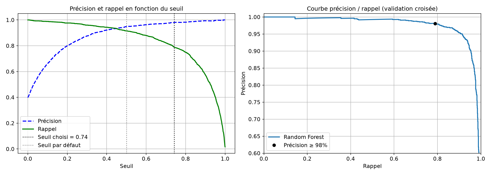

# Email Spam Detector

Classer un email comme **spam** ou **ham** (email normal) avec du machine learning classique (scikit-learn).

Projet de bout en bout qui suit la méthode du livre *Hands-On Machine Learning with Scikit-Learn, Keras & TensorFlow* (A. Géron) : chapitre 2 pour la démarche, chapitre 3 pour le compromis précision / rappel.

## Résultats

Résultats sur le jeu de test (842 emails jamais vus), avec le modèle final (Random Forest) et le seuil choisi :

| Métrique | Score |
|---|---|
| Précision | **98,9 %** |
| Rappel | 80,7 % |
| Accuracy | 91,9 % |
| Vrais emails classés spam | **3 sur 506** |

La **précision** est la métrique principale : envoyer un vrai email dans les spams est plus grave que laisser passer un spam.



## Données

[UCI Spambase](https://archive.ics.uci.edu/dataset/94/spambase) (HP Labs, 1999) : 4 601 emails décrits par 57 variables numériques.

- 48 `word_freq_MOT` : pourcentage des mots de l'email égaux à MOT (`free`, `money`, `hp`…)
- 6 `char_freq_CAR` : pourcentage des caractères égaux à CAR (`!`, `$`, `#`…)
- 3 `capital_run_length_*` : longueur des suites de MAJUSCULES
- `spam` : la cible (1 = spam, 0 = ham)

Le notebook télécharge les données automatiquement si le dossier `data/` est vide.

## Démarche

1. **Problème** : classification binaire ; métrique principale, la précision.
2. **Données** : téléchargement et chargement du jeu UCI.
3. **Premier coup d'œil** : pas de valeur manquante, 391 doublons, variables très asymétriques.
4. **Jeu de test** : doublons supprimés, puis découpage 80 / 20 stratifié, mis de côté tout de suite.
5. **Exploration** (train seulement) : corrélations, distributions spam / ham.
6. **Préparation** : pipeline `log(1 + x)` puis `StandardScaler`.
7. **Comparaison de modèles** par validation croisée (10 plis) : Naive Bayes, régression logistique, SVM, Random Forest.
8. **Fine-tuning** avec `GridSearchCV` : la Random Forest est retenue.
9. **Choix du seuil** : le plus petit seuil qui donne 98 % de précision.
10. **Évaluation finale** sur le jeu de test, avec intervalle de confiance.
11. **Sauvegarde** du pipeline et du seuil avec `joblib`.

| Modèle (validation croisée) | Précision | Rappel | F1 |
|---|---|---|---|
| Random Forest | 94,6 % | 92,3 % | **93,4 %** |
| SVM (RBF) | 93,6 % | 90,9 % | 92,2 % |
| Régression logistique | 92,9 % | 90,8 % | 91,8 % |
| Gaussian Naive Bayes | 72,4 % | 95,3 % | 82,3 % |
| Multinomial Naive Bayes | 77,0 % | 71,9 % | 74,3 % |

## Contenu du dossier

| Fichier | Rôle |
|---|---|
| `spam_detector.ipynb` | Tout le projet, déjà exécuté avec ses résultats et ses graphiques |
| `Spam-Detector-presentation.pptx` | Présentation de 10 slides |
| `data/` | Jeu de données UCI Spambase |
| `images/` | Graphiques produits par le notebook |
| `models/` | Modèle sauvegardé (créé en exécutant le notebook, non versionné) |

## Lancer le projet

```bash
python3 -m venv .venv
source .venv/bin/activate
pip install scikit-learn pandas matplotlib joblib jupyter
jupyter notebook spam_detector.ipynb
```

Testé avec Python 3.12, scikit-learn 1.9 et pandas 3.0.

## Limites et suite

- Données de 1999, venant d'une seule entreprise : des mots comme `hp` ou `george` ne valent pas pour une autre boîte mail.
- Étape suivante : partir des emails bruts (SpamAssassin, Enron-Spam) avec `TfidfVectorizer`.
- Déployer une petite application, puis suivre les performances du modèle dans le temps.
